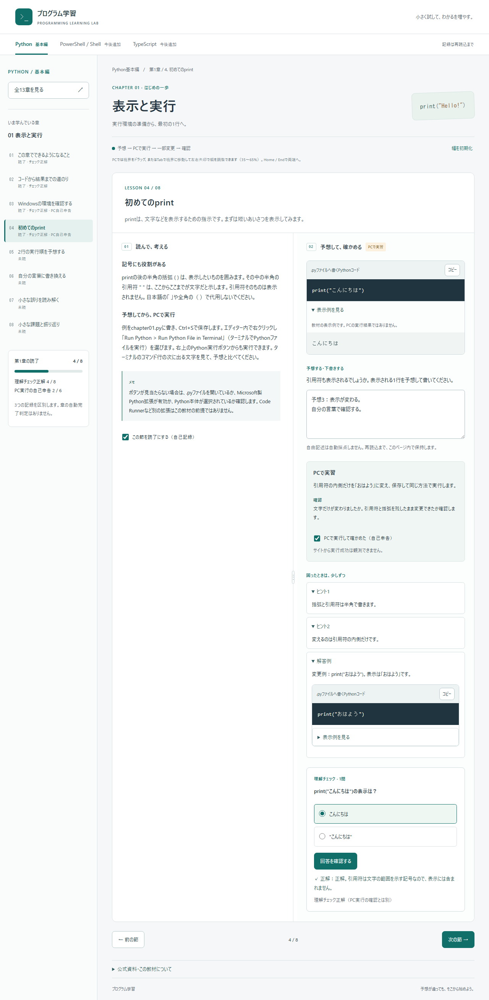
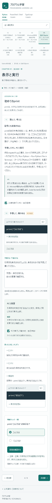

# 第1章の自己検証

2026-11-05 JST / Issue #1。これは実装者による自己検証であり、独立レビューではない。実機Safariの成功をWebKitの結果から推定しない。

## 環境と対象

Windows、Node.js 24.20.0 / npm 11.17.0、Python 3.14.7、Playwright 1.58.2、Chromium 145.0.7632.6 / WebKit 26.0。production buildを127.0.0.1の専用静的サーバーで検査。最終runnerは空きポートを占有して起動・終了まで管理する。各engineで1280×950、390×950、375×950を使用。モバイル幅検査は実iPhoneではなくデスクトップ上のviewport検査。

開始main：`8ace94d`（READMEのみ）。既存サイト・既存lint/typecheck/build・Issue・PRはなし。空だった作業ディレクトリへ対象をcloneし、`feat/python-basics-chapter01`上で実装。既存READMEの長期方針を保持し、現在の実装案内を追加した。参照元リポジトリは変更していない。

## 検査と証拠

- `npm run check`：lint、strict TypeScript、教材構造のNode検査2件、production buildを確認。
- `node tools/verify-python.mjs`：教材中の固定Pythonコードを実Pythonで実行。通常9例の標準出力一致、意図的なSyntaxError1例を別分類で確認。[版・コード・出力・exit code](evidence/python-results.json)。WindowsのCRLFは比較時のみLFへ正規化し、記録には原文を保持。
- `npm audit`：新規依存の警告を修正版・overrideで対処し、最終確認0件。[監査JSON](evidence/npm-audit.json)。本番へのPython・AI・任意実行依存なし。
- `npm run test:e2e`：**最終27成功・3未実施・失敗0、終了コード0**。[結果JSON](evidence/browser-results.json)。各engine×3幅で、8節の通し学習、空回答・誤答理由・次のヒント・選び直し・明示判定、段階ヒントと解答、全章一覧、入力／回答／開いたヒントの往復保持、再読込での消去、記録3区分を検査。
- Clipboard APIの成功／拒否を注入してコピー本文を厳密比較、失敗時に成功通知が残らないことを両engine×3幅で確認。別にnative API応答も確認。Chromiumは権限を検査contextに与え、コマンド・2行Pythonのnative readbackとCtrl+V貼り付けを確認（Windows改行は正規化）。WebKitのOS貼り付けは下記の未検証扱い。
- PCではseparatorをTab焦点・左右矢印/Home/Endで操作し、実マウスドラッグ、初期化、左右配置を確認。スマホ幅ではseparatorが隠れ、説明の後に課題が縦配置されることをgeometryで確認。
- 日本語の合成compositionstart/endと変換中Enter、textarea入力保持を検査。Space／Enterでチェック・ヒントを操作。root font-size 200%により本文のcomputed font-sizeが実際に2倍となることを実測し、8節・章一覧の文書横超過なしを確認。動き低減でも内容・操作・判定を保持。
- pageerrorとerrorコンソールを通し学習で収集し、重大エラーなしを検査。既存サイトがなかったため既存機能の回帰対象はREADMEとリポジトリ管理情報。

## 画面画像

[screenshots](evidence/screenshots/)に、両engine×1280/390/375の開始、環境準備、print、最終課題、章一覧、文字200%＋動き低減を保存。代表画像：

|PCの比較表示|375pxの縦表示|
|---|---|
|||

画像は教材画面のキャプチャであり、学習者のPCのPython実行を証明するものではない。目視は、開始画面のChromium PC/375、両engineのPC環境準備、printの全6幅条件、両engineの375px最終課題、両engineの390px章一覧、Chromium375/WebKit390の文字2倍を代表として確認した。本文・コード・ヒント・チェック・前後操作の欠け、縦／横の配置、未完成表示を確認。全36画像の全テキストを目視保証したという意味ではなく、全条件の横超過・操作は自動検査と組み合わせて評価した。

## 途中失敗と切り分け

1. npmの初回は証明書検証に失敗。検証無効化をせず`NODE_OPTIONS=--use-system-ca`をそのシェルに指定し、OSのCAで導入成功。
2. Python検証の初回はWindows CRLFと期待LFの差で拒否。コードの実行失敗ではない。出力原文を維持して比較だけ正規化し、同じ例9件とエラー例1件を再検証。
3. 初回ブラウザーrunnerは既存の別サイトの4173ポートを再利用して誤接続。中断し、専用43871・strictPort・再利用禁止に変更。誤接続したサイトの画像を本教材の証拠には含めない。
4. [attempt02](evidence/attempt02/browser-results.json)は13成功／11失敗。6条件はネストしたsummaryに対する曖昧なlocator、2条件は縦に長いseparatorの画面外座標をドラッグしたrunnerの誤り。直接子summaryへ限定し、表示中の座標から同じドラッグを行うよう修正。製品コードは変えておらず、製品RED→GREENとは扱わない。残る3条件はWebKitのnative pasteで、writeText成功応答後もCtrl+Vで文字が入らなかった。読み出しも拒否され、OS clipboardとの接続が確認できない。実Safariの不具合とは断定しない。
5. [attempt03](evidence/attempt03/browser-results.json)は21成功／6失敗／3未実施。Chromiumの3条件はnative clipboardがLFをCRLFへ変換する差だけで、本文とコマンドに差はない。比較時にWindows改行を正規化。WebKitの3条件は8節通し操作が30秒を超えたため、assertを減らさず90秒枠で同じ操作を再実施。WebKitのOS貼り付け3条件は未実施を明示。
6. Vite設定追加後、修正版esbuildの設定bundle処理が制限環境の親ディレクトリ探索で拒否された。`--configLoader native`に変更し、同じbuildが成功。アクセス権・セキュリティ設定は変更していない。
7. 通し検査は一度27成功／3未実施となった（[attempt04](evidence/attempt04/browser-results.json)）。その後、目視で全ページ画像の途中にスキップリンクが写り込む問題を発見し、画面外への位置移動ではなく非フォーカス時のclipへ変更。[修正前390px画像](evidence/visual-before/chromium-390-print.png)と最終の同条件画像を比較する。
8. スキップリンクへfocus→Enter→mainにfocus、という追加検査で6条件中5条件が失敗（1条件はイベント順のため先にassertを通過）。`#main`への移動を節ルーティングと誤認して見出しへfocusを戻す製品不具合だった。`hashchange`で`#main`を区別する局所修正を行い、同じ操作を最終6条件で再検証。[修正前の5失敗原文](evidence/skip-before/errors.json)。この局所実行は終了処理が完了せず中断したため、最終reporter JSONの代わりに生成済みtraceから失敗原文を抽出・保存した。最終の通し結果に混ぜない。
9. 修正後の27操作検査は通過したが、WindowsでPlaywrightのwebServerプロセスツリー終了が完了せず、reporter JSON・終了コードが確定しなかったため中断。`tools/browser-test.mjs`で静的サーバーを親Nodeプロセスが所有し、空きポートで起動、Playwright子プロセスの終了時にHTTP接続とサーバーを閉じる方式へ変更。最終実行は同じproduction buildと全30条件で、assertを省略せず再検証する。

1〜6と9はrunner／環境の切り分け、7〜8は目視と追加操作から見つかった製品の局所修正。最終実行はサーバー終了まで成功し、修正前に失敗した本文スキップ操作も6条件すべてで成功。製品の期待値を緩めて合格に置き換えていない。過去の結果JSONを最終結果として集計しない。[検証したソース16ファイルのSHA-256](evidence/source-manifest.json)と[画像36枚の寸法・SHA-256](evidence/image-manifest.json)も記録する。

## 未実施・確認限界

- 実機iPhone Safari、実タッチ、VoiceOverなど支援技術による実読み上げ：対象機器・利用セッションなし。WebKitによる代替検査のみ。
- OSの日本語IMEによる実変換：Computer UseのEdgeアプリ接続が承認待ちでタイムアウト。設定変更や追加承認要求で継続せず、合成compositionイベントの検査に限定。
- OSの物理文字拡大・ブラウザーの実ズーム：rem本文を実測して2倍にするCSS検査で代替。実機の設定成功とは呼ばない。
- Windows Playwright WebKitのOS clipboard readback／貼り付け：上述の環境上の制約により未検証。3幅の当該検査をskipし理由をJSONに記録。Promise成功と実クリップボードの読み戻しを混同しない。
- 利用者PCのインストールやVS Codeの実画面一式：公式の最新操作資料で確認。学習者の環境では未観測。自動導入・設定変更なし。
- 公開後のURL、配信CSP、実ホストでの操作：公開先未設定、本依頼はDraft PRまでのため未実施。
- 独立レビュー：未実施。Draftを維持して提出し、マージ・自動マージを設定しない。

第2章以降、ブラウザー内Python実行、永続保存・バックアップ、他言語と応用編は[後続候補](architecture.md)として保持。

## 提出用チェックアウト

現在の作業ルートでは`.git/index.lock`の作成が権限で拒否された。読み取り専用のGitメタデータを変更せず、`.work/submission`に対象リポジトリの新しい分離チェックアウトを作り、検証したソース・文書・画像のみを同じ作業ブランチへ移してcommit・pushする。元の作業ファイルは保全する。提出ソースは上記source-manifestと一致を確認し、参照コピー・依存フォルダー・一時ファイルは含めない。
